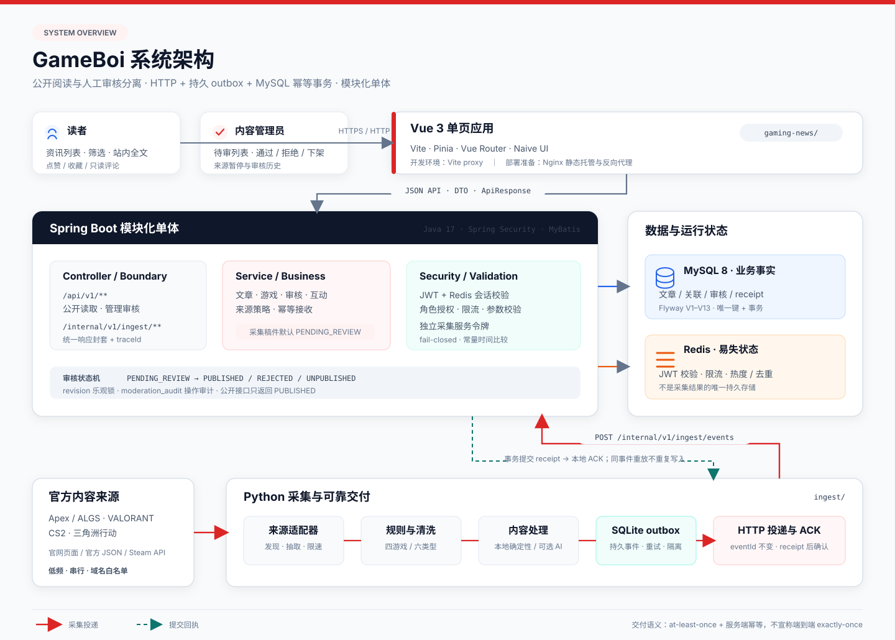

# GameBoi — 游戏资讯平台

> 面向 **三角洲行动、VALORANT、CS2、Apex Legends** 的资讯采集、人工审核与站内阅读平台。

GameBoi 将不同官网的公告、版本更新、活动和赛事资讯转换为统一文章模型。系统采用 **Vue 3 + Spring Boot 模块化单体 + Python 采集管线**，通过持久 outbox、服务端幂等事务和人工审核，把「抓到内容」与「公开内容」明确分开。

**当前状态：持续开发中，尚未部署生产环境，未开启自动发布。** 四款游戏均已有官方来源适配或注册记录，但来源数量、冻结标注集、资源实测、备份恢复和发布审批仍未全部完成。发布门禁以 [上线完成审计](docs/COMPLETION_AUDIT.md) 为准。

## 核心能力

- **精准内容边界**：四游戏白名单与六类内容模型；确定性规则输出 `ACCEPT / REVIEW / REJECT`，不把模型置信度当作准确率。
- **可靠采集交付**：来源适配、正文抽取、本地或可选 AI 清洗、SQLite outbox、有限重试、异常隔离与 receipt 确认。
- **服务端幂等**：`eventId + payloadHash` 识别重放与冲突，文章、正文、游戏关联和 receipt 在同一 MySQL 事务中提交。
- **人工审核优先**：采集稿件统一进入 `PENDING_REVIEW`；管理员通过后才公开，支持拒绝、下架、revision 乐观锁和审核历史。
- **统一阅读体验**：游戏与内容类型筛选、分页、站内全文、原文入口、点赞、收藏和只读评论；公开正文以纯文本渲染。
- **安全与容量边界**：JWT + Redis 会话校验、角色授权、独立采集令牌、请求限流、容量闸门与独立 Compose 配置。

## 系统架构



### 两条主链路

**公开阅读与管理**

```text
读者 / 管理员 → Vue 3 → /api/v1 → Spring Security → Service → MySQL / Redis
```

公开文章接口只返回 `PUBLISHED` 内容；列表使用不含全文的 DTO，详情按阅读模式返回正文或摘要。管理操作要求 `CONTENT_ADMIN` 或 `SUPER_ADMIN`，前端路由守卫不作为安全边界。

**采集、投递与审核**

```text
官方来源 → 适配器 → 规则分类 / 内容清洗 → SQLite outbox
  → POST /internal/v1/ingest/events → MySQL 事务 + receipt
  → PENDING_REVIEW → 管理员审核 → PUBLISHED
```

采集端先持久化事件再发送 HTTP；只有收到并校验后端提交回执，才将本地事件标记为 `ACKED`。同一 `eventId` 重试不会重复产生业务效果，同一 `eventId` 携带不同载荷会返回 `409`。

交付语义是 **at-least-once + 服务端幂等**，不是端到端 `exactly-once`。Python 不持有业务数据库凭据，Redis 也不是采集结果的唯一持久存储。

## 技术栈

| 层 | 技术与职责 |
|---|---|
| 前端 | Vue 3.5 · Vite 8 · Pinia · Vue Router · Naive UI · Vitest |
| 后端 | Spring Boot 4.0.5 · Spring Security · MyBatis 4.0.1 · Java 17 |
| 数据 | MySQL 8 · Flyway V1–V13 · Redis（会话、限流、热度与采集去重） |
| 采集 | Python 3.11+ · httpx · BeautifulSoup4 · lxml · Pydantic · Click |
| 可靠性 | SQLite outbox · HTTP receipt · MySQL 唯一约束与事务 |
| 可选处理 | DeepSeek；`--no-ai` 使用本地确定性处理器，不调用模型 |
| 部署准备 | Docker Compose · Nginx · 独立网络、数据卷与资源限额 |

## 快速开始（Windows / PowerShell）

### 环境要求

- JDK 17+
- Node.js `^20.19.0` 或 `>=22.12.0`（与当前 Vite engines 对齐）
- Python 3.11+
- MySQL 8.0 / 8.4
- Redis 5+，建议 7.x

### 1. 准备空数据库

```powershell
mysql -u root -p -e "CREATE DATABASE big_event CHARACTER SET utf8mb4;"
```

后端启动时由 Flyway 自动执行 V1–V13。**不要直接对历史 `big_event` 数据库启动自动迁移**；旧库必须先备份并在隔离副本中预演，详见 [数据库迁移说明](docs/DATABASE_MIGRATION.md)。

### 2. 启动后端

在项目根目录设置必填环境变量。仓库不保存真实凭据，缺少任意必填项都会启动失败。

```powershell
$env:DB_USERNAME = "<本地数据库用户>"
$env:DB_PASSWORD = "<本地数据库口令>"
$env:JWT_SECRET_KEY = "<至少 32 字符的随机串>"
$env:INGEST_SERVICE_TOKEN = "<独立采集服务令牌>"

.\mvnw.cmd spring-boot:run
```

默认后端地址为 `http://localhost:8080`。如需覆盖数据库或 Redis 地址：

```powershell
$env:SPRING_DATASOURCE_URL = "jdbc:mysql://<host>:3306/big_event?useUnicode=true&characterEncoding=utf8&serverTimezone=Asia/Shanghai&useSSL=false&allowPublicKeyRetrieval=true"
$env:SPRING_DATA_REDIS_HOST = "<redis-host>"
$env:SPRING_DATA_REDIS_PORT = "6379"
```

若宿主环境已注入 `SERVER__PORT`，先执行 `Remove-Item Env:SERVER__PORT`，避免后端端口被意外改写。SQL 明细日志只在显式启用 `dev` profile 时开启。

### 3. 启动前端

另开一个 PowerShell 终端：

```powershell
Set-Location gaming-news
npm ci
npm run dev
```

访问 `http://127.0.0.1:5173`。Vite 会保留 `/api/v1` 路径并代理到后端；legacy 请求会去掉 `/api` 前缀后转发。

## 采集管线

### 已注册来源

下表以当前 V1–V13 迁移中的注册基线为准；管理员暂停状态优先于种子默认值。

| 来源编码 | 内容范围 | 注册状态 |
|---|---|---|
| `valorant-official` | VALORANT 官方更新 | `SHADOW` |
| `valorant-esports-official` | VALORANT 官方赛事 | `FETCH_VERIFIED` |
| `apex-official` | Apex Legends 官方资讯 | `SHADOW` |
| `algs-official` | ALGS 官方赛事 | `FETCH_VERIFIED` |
| `delta-force-garena-official` | 三角洲行动国服官网「新闻」栏目 | `SHADOW` |
| `cs2-official` | CS2 Steam 第一方公告 | `FETCH_VERIFIED` |

- `FETCH_VERIFIED`：已验证受控抓取与解析样本，真实管线不会放行，只能 dry-run。
- `SHADOW`：允许采集入库，但所有稿件仍进入人工审核。
- `AUTO_ENABLED`：当前没有来源处于此状态；`auto_publish_enabled` 也不是现有入库链路的发布旁路。

来源证据、地区范围和后续验证项见 [来源验证登记](docs/SOURCE_EVALUATION.md)。

### 安装与 dry-run

```powershell
Set-Location ingest
python -m venv .venv
.\.venv\Scripts\Activate.ps1
pip install -r requirements.txt

# 只抓取、分类并打印；不写 Redis / SQLite / outbox，不调用 AI，不入库
python main.py --source valorant-official --dry-run
```

### 真实采集（本地确定性处理）

真实运行前必须同时满足：后端已启动、内部地址与服务令牌已配置、目标来源为 `SHADOW`、容量快照有效。缺少容量快照时管线会 fail-closed，不会继续生成新事件。

```powershell
Copy-Item .env.example .env
# 编辑 .env：INGEST_INTERNAL_BASE_URL、INGEST_SERVICE_TOKEN、CAPACITY_SNAPSHOT_PATH

python main.py --source delta-force-garena-official --no-ai
```

默认每日最多处理 80 个候选，outbox 与运行状态合计软上限 50 MB。未确认事件不会因普通 TTL 被删除；只读排查与人工重放入口见 [Outbox 运维说明](docs/OUTBOX_OPERATIONS.md)。

> 付费 AI、对象存储和图片采集均未作为当前默认链路启用。使用 `--no-ai` 可完全避免模型调用。

## 主要接口

| 分组 | 代表接口 | 访问边界 |
|---|---|---|
| 公开读取 | `GET /api/v1/games`、`GET /api/v1/articles`、`GET /api/v1/articles/{id}` | 仅已发布内容 |
| 公开评论 | `GET /api/v1/articles/{id}/comments` | 分页只读；提交默认关闭 |
| 个人收藏 | `GET /api/v1/me/favorites` | 登录用户，仅本人数据 |
| 管理审核 | `GET /api/v1/admin/articles`、`POST .../{id}/approve|reject|unpublish` | 内容管理员 / 超级管理员 |
| 审核历史 | `GET /api/v1/admin/articles/{id}/audit` | 内容管理员 / 超级管理员 |
| 来源运营 | `GET /api/v1/admin/sources`、`POST .../sources/{code}/pause|resume` | 内容管理员 / 超级管理员 |
| 内部采集 | `GET /internal/v1/ingest/sources/{code}/policy`、`POST /internal/v1/ingest/events` | 独立服务令牌，不使用用户 JWT |

v1 响应统一包含 `code`、`message`、`data` 和 `traceId`。完整字段、状态码与兼容期策略以 [OpenAPI 契约](docs/api/openapi.yaml) 和 [API 兼容说明](docs/API_COMPATIBILITY.md) 为准。

## 配置速查

### 后端

| 环境变量 | 说明 |
|---|---|
| `DB_USERNAME` / `DB_PASSWORD` | 数据库账号与口令，必填 |
| `JWT_SECRET_KEY` | JWT HS256 签名密钥，必填 |
| `INGEST_SERVICE_TOKEN` | 内部采集服务令牌，必填且 fail-closed |
| `SPRING_DATASOURCE_URL` | 数据库连接串覆盖 |
| `SPRING_DATA_REDIS_HOST` / `_PORT` | Redis 地址覆盖 |
| `GAMEBOI_FLYWAY_TEST_URL` | 仅用于隔离 MySQL 门禁测试，不得指向业务库 |

### 采集端

| 环境变量 | 说明 |
|---|---|
| `INGEST_INTERNAL_BASE_URL` | 后端地址，如 `http://127.0.0.1:8080` |
| `INGEST_SERVICE_TOKEN` | 必须与后端采集令牌一致 |
| `CAPACITY_SNAPSHOT_PATH` | 新鲜、完整的项目容量快照；缺失或失效时停止新增采集 |
| `RUNTIME_STATE_PATH` / `OUTBOX_PATH` | 运行状态与持久 outbox 文件位置 |
| `MAX_CANDIDATES_PER_DAY` / `MAX_OUTBOX_PENDING` | 每日候选与待交付事件上限 |
| `REDIS_HOST` / `REDIS_PORT` / `REDIS_PASSWORD` | URL 去重与运行统计 |
| `DEEPSEEK_API_KEY` | 仅使用 AI 处理器时需要；不得提交到仓库 |

完整占位模板见 [`ingest/.env.example`](ingest/.env.example) 和 [`deploy/.env.example`](deploy/.env.example)。

## 测试与检查

在项目根目录执行：

```powershell
# OpenAPI、资源预算、后端、前端与 Python 汇总检查
.\scripts\check.ps1

# 后端（真实 MySQL 用例需单独配置隔离实例）
.\mvnw.cmd test

# 前端
Set-Location gaming-news
npm test
npm run build
Set-Location ..

# Python 采集管线
Set-Location ingest
python -m unittest discover -s tests -t .
Set-Location ..
```

浏览器回归使用 `.\scripts\check.ps1 -Browser`，依赖与覆盖范围见 [浏览器测试说明](docs/WEB_BROWSER_TESTS.md)。真实 MySQL 测试必须指向独立实例，测试库约定与示例见 [数据库迁移说明](docs/DATABASE_MIGRATION.md)。

`scripts/check.ps1` 使用 `$ErrorActionPreference = 'Stop'`，可能把原生命令的 stderr 警告升级为失败。遇到 `FAIL` 时，应单独运行底层命令并核对退出码，不把警告直接等同为测试失败。

## 目录结构

```text
gaming/
├── src/main/java/org/example/bigevent/
│   ├── controller/       # REST 入口：接收请求、包装响应
│   ├── service/          # 业务接口
│   │   └── impl/         # 业务实现与事务边界
│   ├── mapper/           # MyBatis 数据访问
│   ├── pojo/dto/         # 公开、管理、内部接口 DTO
│   ├── security/         # JWT 认证过滤器
│   ├── filter/           # traceId 与内部采集请求边界
│   ├── exception/        # v1 与 legacy 异常响应
│   └── task/             # 定时任务
├── src/main/resources/
│   ├── application.yml
│   └── db/migration/     # Flyway V1–V13
├── gaming-news/          # Vue 3 前端、Vitest 与构建配置
├── ingest/
│   ├── spiders/          # 官方来源适配器
│   ├── filters/          # 四游戏 / 六类型确定性规则
│   ├── agent/            # 本地处理器与可选 DeepSeek 处理器
│   ├── runtime/          # outbox、状态锁、容量、投递与重放
│   └── quality/          # 候选准备与冻结集质量评估
├── deploy/               # Dockerfile、Compose、Nginx 与配置模板
├── scripts/              # 统一检查与契约验证
└── docs/                 # 设计、契约、来源、运维与架构图
```

后端分层和新增类放置规则见 [包结构约定](docs/PACKAGE_STRUCTURE.md)。

## 当前边界

- **未生产上线**：Compose 已完成静态配置与预算检查，但镜像 digest、真实构建启动、cgroup/磁盘实测、备份恢复和发布审批仍未闭环。
- **未自动发布**：真实 160+ 条人工标注冻结集与逐来源质量门禁尚未完成；不能将 `SHADOW` 视为自动发布。
- **评论只读**：历史评论可分页读取，新评论提交在服务端默认关闭，等待运营处置、限流和容量验收。
- **不采集图片**：当前正文管线只处理文本，不搬运正文图片或封面；OSS 配置保留但未接入默认采集链路。
- **保留兼容代码**：legacy API 仍用于部分用户与互动能力；旧 Redis List 消费入口和 `/push/**` 默认禁用，不作为正式采集链路。
- **推送 demo 依赖 Redis Streams**：若在本机使用 Redis 3.x，相关定时任务会报未知命令；公开读取、登录和热度不依赖该 demo。

## 文档导航

| 文档 | 用途 |
|---|---|
| [产品与架构基线](docs/PROJECT_DESIGN.md) | 产品边界、目标架构、资源预算与发布门禁 |
| [持续开发计划](docs/DEVELOPMENT_PLAN.md) | 任务依赖、实施范围与验收定义 |
| [任务状态](feature_list.json) | 当前任务状态与证据的唯一记录 |
| [执行进度](claude-progress.md) | 按时间追加的实施与验证记录 |
| [上线完成审计](docs/COMPLETION_AUDIT.md) | 区分已验证工程能力与未关闭发布条件 |
| [OpenAPI 契约](docs/api/openapi.yaml) | v1 / internal 接口字段与状态码 |
| [来源验证登记](docs/SOURCE_EVALUATION.md) | 来源入口、实测证据、地区范围与限制 |
| [Outbox 运维](docs/OUTBOX_OPERATIONS.md) | 只读排查、隔离与受控重放 |
| [备份恢复手册](docs/BACKUP_RECOVERY_RUNBOOK.md) | 隔离恢复范围、审批门禁与演练验收 |
| [协作约定](AGENTS.md) | 权限边界、环境隔离与每轮开发流程 |

历史文档 `CLAUDE.md`、`DEVELOPMENT.md`、`Failures.md` 仅作背景；与当前设计和任务状态冲突时，以现行基线为准。

## License

[MIT](LICENSE) © 2026 tsunami243
